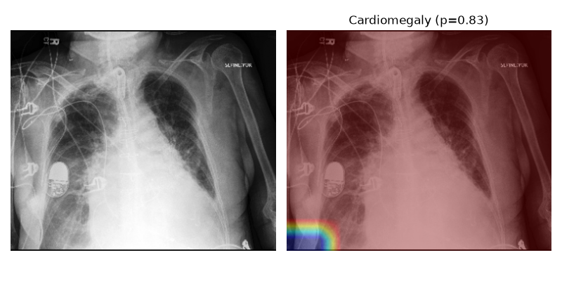
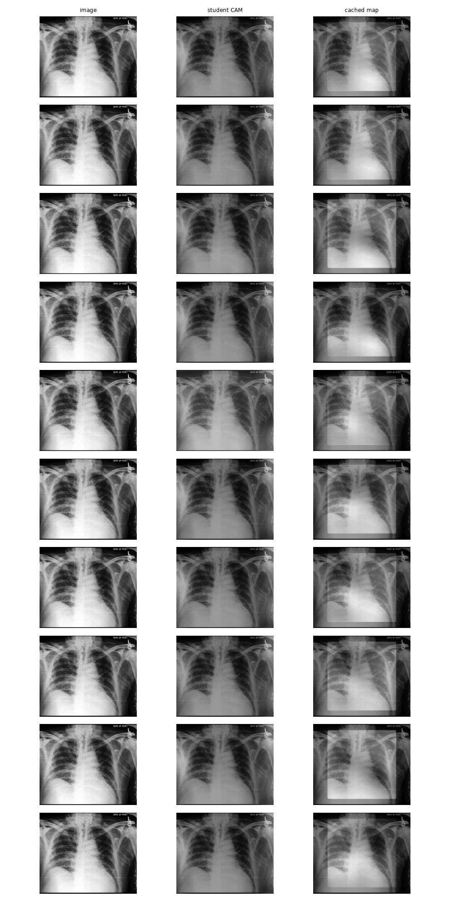

# ConceptKD-CXR

Concept-guided knowledge distillation for multi-label chest X-ray classification on CheXpert (5 competition labels: Atelectasis, Cardiomegaly, Consolidation, Edema, Pleural Effusion).

A frozen **teacher** (ConvNeXt from `mamounyosef/chest-xray-bench`) and **BioViL-T** concept targets are cached once; a small **student** (any timm CNN, default EfficientNet-B0) trains with supervised BCE + temperature-scaled KD + concept score/map losses. Teacher and BioViL-T are never loaded during training.

## Layout

```
common.py            paths, labels, preprocessing, canonical cache keys
teachers.py          teacher registry + cache/list CLI
concepts.py          concept-source registry + selftest/cache/viz CLI
concept_vocab.json   10 radiology concepts (pos/neg prompts, related label)
students.py          timm CNN student registry (EffNet-B0, ResNet, MobileNetV3...)
train.py             single train/eval entry point (B1/B2/B3/Ours/C1/Ours+map)
gradcam.py           standalone Grad-CAM / concept-CAM figures from a checkpoint
configs/default.yaml default hyperparameters (CLI flags override)
cache/               generated teacher_<name>.pt, concepts_<source>.pt
runs/                per-run: metrics.json, history.csv, best/last.pth
```

## Setup

```bat
conda activate prog
pip install -r requirements.txt
```

Dataset: CheXpert CSVs + images under `..\Dataset` (outside this repo). Debug subset: `..\Dataset\train_100.csv` (87 frontal images).

## Pipeline

```bat
python teachers.py cache --teacher xray-bench:convnext_tiny --csv ..\Dataset\train_100.csv
python concepts.py selftest
python concepts.py cache --source biovilt --csv ..\Dataset\train_100.csv

python train.py --mode Ours --epochs 30
python train.py --mode Ours+map --overfit --epochs 30
python train.py --mode C1 --epochs 2
python train.py --mode Ours --student resnet18 --epochs 2
python train.py --mode B2 --teacher-cache cache\teacher_xray-bench_densenet121_seed7.pt --epochs 2

python train.py --eval-only --ckpt runs\<run_name>\best.pth
python gradcam.py --n 3
```

Each run writes `runs/<run_name>/metrics.json` (per-label AUROC/AUPRC, Youden-J F1/sensitivity/specificity, Brier, ECE + reliability diagram, concept MAE/Pearson, params, MACs, latency, peak GPU memory), `history.csv`, `best.pth`, `last.pth`, and optional Grad-CAM overlays.

## What the student learns

Grad-CAM on the disease head (right = where the model looked):



Student concept CAMs vs cached BioViL-T target maps (middle vs right; rows are the 10 concepts):



## Notes

- Input: 320x384 grayscale, aspect-fit + zero padding, ImageNet norm. **No horizontal flip** (anatomy must not be mirrored).
- Labels: blanks (NaN) = negatives by default (`--blank-policy zero`); uncertain (-1) masked (`--uncertain-policy mask`).
- Windows-safe: `num_workers=0`, AMP + GradScaler, OOM batch-size fallback.
- Teacher weights and caches are gitignored; re-downloaded / regenerated by the commands above.
